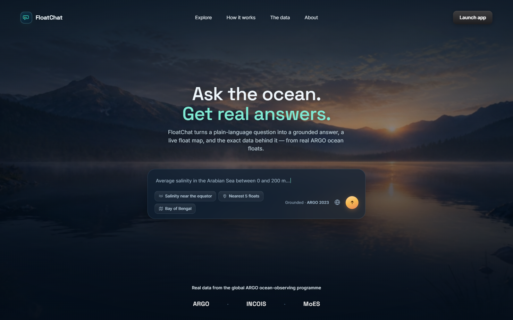
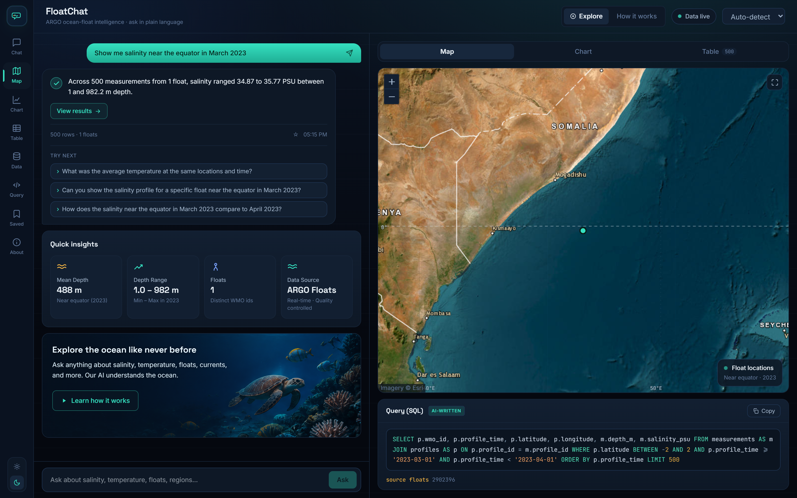
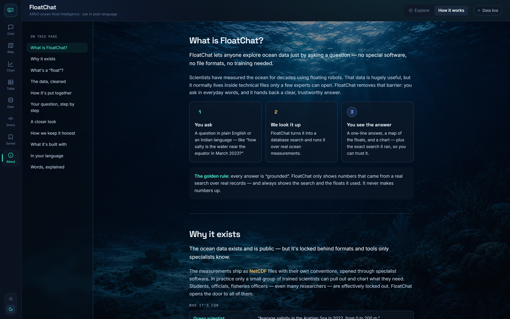
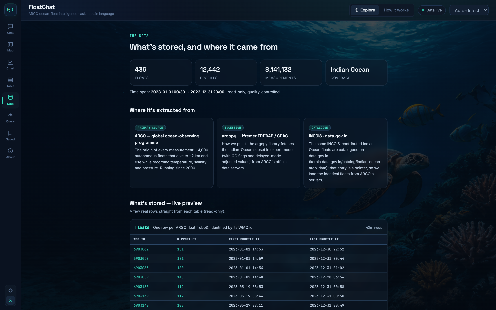
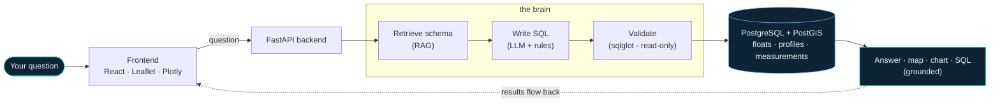

<div align="center">



# 🌊 FloatChat

### Ask the ocean a question in plain language — get a grounded answer, a live float map, and the exact data behind it.

Built on real **ARGO** ocean-float data · a **Fisheries** layer (INCOIS PFZ · satellite SST · chlorophyll) · works in **5 languages** · every answer is **grounded** in real records.


<sub>ANALYTICA 2026 · Problem PS26-033 · MoES / INCOIS</sub>

**🌐 Live demo: <http://80.225.245.19>**

<sub>Runs on an Oracle Cloud Always Free 1 GB VM, so only part of the ARGO archive is loaded (Indian Ocean, 2023) — the app shows a notice with the exact window on launch. Plain HTTP; no account needed.</sub>

</div>

---

## The problem

The ocean is measured and the data is **public** — but it ships as **NetCDF** files with quality-control flags, delayed-mode conventions, and pressure-vs-depth quirks. To answer *one* question you need specialist tools and code first. In practice only a handful of trained scientists can use it; students, fisheries officers, policymakers and the public are locked out.

**FloatChat removes that barrier.** You ask in plain words; it does the rest — and shows its work.

## What you get, from one question

| | |
|---|---|
| 🗣️ **Ask naturally** | *"Average salinity in the Arabian Sea in 2023, 0–200 m"* — English, हिन्दी, தமிழ், বাংলা, or తెలుగు |
| ✅ **A grounded answer** | one plain sentence — **every number comes from a real record**, nothing invented |
| 🗺️ **A live float map** | the relevant ARGO floats on a satellite map (Leaflet + PostGIS) |
| 📈 **A depth / time chart** | depth profiles and monthly trends, drawn automatically |
| `</>` **The exact SQL** | the query and the source float IDs, shown under every answer |
| 🎣 **Fisheries tab** | PFZ advisories, satellite SST and chlorophyll on the same map — *"Is the water warm enough for tuna near Kochi this week?"* |

## A look at it

**One plain-language question → a grounded answer, a live float map, and the exact SQL.**



<sub>*“Show me salinity near the equator in March 2023” → answered from 500 real measurements, mapped on the equator, with the query it ran shown underneath.*</sub>

<table>
<tr>
<td width="50%" valign="top"><b>A built-in, plain-language explainer</b><br><sub>“How it works” walks anyone — no jargon — from a question to a grounded answer, with the golden rule: it never invents numbers.</sub><br><br></td>
<td width="50%" valign="top"><b>Every number, traceable to its source</b><br><sub>The Data tab shows what’s stored, where it came from (ARGO · argopy · INCOIS), and a live preview of the real tables.</sub><br><br></td>
</tr>
</table>

## 🧠 How it works

Your plain-language question becomes a **safe, validated, read-only query** over real ARGO data:



1. **Detect language** → translate to English if needed (place names preserved).
2. **RAG** retrieves the relevant schema so the model can only use **real** tables & columns.
3. The **LLM** (or an offline **rule engine**) writes **one** SQL statement.
4. **sqlglot** validates it — a single read-only `SELECT` over seven allow-listed tables (four ARGO + three fisheries), or it's rejected.
5. It runs on a **read-only role** with a 5-second timeout.
6. Results become a **grounded** sentence, a map, and a chart — with the SQL shown.

> **Why "grounded"?** The answer sentence is checked to contain no number that isn't in the query result. The model writes the SQL and phrases the answer — it never invents the data.

## 🐟 The data

Real **ARGO** floats — a global fleet of ~4,000 robots measuring the upper ocean since 2000. The pilot loads the **Indian Ocean, 2023**:

| | | | |
|---|---|---|---|
| **12,442** profiles | **8.1M** measurements | **5** languages | **36/36** tests green |

Sourced from ARGO's official servers via [`argopy`](https://github.com/euroargodev/argopy) — the same INCOIS floats catalogued on [data.gov.in](https://kerala.data.gov.in/catalog/indian-ocean-argo-data) — cleaned (keep QC 1–2, prefer delayed-mode adjusted values, TEOS-10 depth) and pre-loaded so it runs offline.

## 🎣 Fisheries

The same engine, pointed at the data fishermen actually use. A separate **Fisheries** tab (and the landing-page *Fisheries* link) adds three tables next to the ARGO ones, all reachable through the same plain-language → SQL pipeline:

| Table | What it holds | Source |
|---|---|---|
| `sst_composites` | daily gridded sea-surface temperature + anomaly | **NOAA OISST v2.1** (open, via CoastWatch ERDDAP) · plus SST from the ARGO floats already loaded |
| `chlorophyll` | chlorophyll-a (mg/m³) — plankton blooms = productive grounds | **NOAA VIIRS** daily 4 km (open) · ISRO OCM archives loadable |
| `pfz_advisories` | Potential Fishing Zones — zone, validity, likely species, SST / chlorophyll at the zone | **derived** from the two grids above with the INCOIS PFZ recipe (warm SST band + high chlorophyll near each port) · official INCOIS exports loadable |

Every row carries a `source` tag and the Fisheries tab lists exactly what is loaded. INCOIS publishes PFZ advisories as bulletins/SMS rather than an open feed, so the derived zones are labelled as such — never as INCOIS advisories.

Ask in fishermen's words: *"Current fishing zones near Kochi"*, *"Which zones have sardine right now?"*, *"Is the water warm enough for tuna near Chennai?"*, *"Show me chlorophyll hotspots in the Bay of Bengal"*. The rule engine knows Indian ports (Kochi, Chennai, Visakhapatnam, Mumbai, Mangalore, Tuticorin, Paradip, Goa…), fish names in Hindi / Tamil / Bengali / Telugu / Malayalam, and relative time ("this week", "right now"). PFZ points draw in amber on the satellite map with species and validity in the popup; the tab also carries a seasonal (monsoon) guide and works from the last synced data when connectivity drops at sea.

Loading the layer:

```bash
.venv/Scripts/python -m ingest.fisheries_fetch          # real NOAA SST + VIIRS chlorophyll, derive fishing zones
```

```bash
.venv/Scripts/python -m ingest.fisheries --sst-from-argo   # add SST from the loaded ARGO profiles
```

`ingest.fisheries_fetch` needs no account (`--days 30` for a longer window; re-runs replace the window). It reads NOAA's `ncdcOisst21NrtAgg` (SST, 0–360° longitude) and `nesdisVHNSQchlaDaily` (chlorophyll) grids from CoastWatch ERDDAP. On the deployed server it runs automatically every night (`deploy/install_cron.sh`), so the satellite layer stays current on its own. `ingest.fisheries --csv-dir data/fisheries` loads INCOIS / ISRO exports (column layout documented in the module); `--demo` inserts clearly-labelled sample rows (`source = 'DEMO'`) for offline demos.

## 🛠️ Tech stack

| Layer | Choice |
|---|---|
| **Frontend** | React · Vite · Tailwind · Leaflet (satellite map) · Plotly |
| **Backend** | Python · FastAPI · psycopg (v3) |
| **Database** | PostgreSQL 16 + **PostGIS** (spatial, counts, nearest-float) |
| **NL → SQL** | LLM (Groq / OpenAI / Anthropic / Ollama) grounded by **RAG**, with a deterministic **rule-based fallback** |
| **Retrieval** | TF-IDF schema index (offline) · optional MiniLM embeddings |
| **Safety** | `sqlglot` validation · read-only role · statement timeout · grounding check |
| **Data** | `argopy` · `xarray` · `gsw` (TEOS-10) · Docker Compose |

## 🚀 Run it locally

> Prereqs: Python 3.11+, Node 18+, Docker. Full setup, LLM config, and deployment are in the **[Complete Guide](docs/FloatChat-Complete-Guide.md)**.

```bash
cp .env.example .env
docker compose up -d db                                   # PostgreSQL + PostGIS
python -m venv .venv && .venv/Scripts/pip install -r requirements.txt
.venv/Scripts/python -m ingest.build_db --start 2023-01-01 --end 2024-01-01   # once
.venv/Scripts/python -m ingest.fisheries_fetch && .venv/Scripts/python -m ingest.fisheries --sst-from-argo   # fisheries layer
.venv/Scripts/python -m rag.index
.venv/Scripts/python -m uvicorn app.main:app --port 8000  # API
cd frontend && npm install && npm run dev                 # → http://localhost:5173
```

Works fully **offline** with `LLM_PROVIDER=none` (the rule engine handles the core queries). If port 8000 is taken, run the API on another port and set `API_PORT` for the frontend (e.g. `API_PORT=8001 npm run dev`).

## ☁️ Deploy

One Oracle Cloud **Always Free** VM runs the whole stack with Docker Compose (PostGIS + API + Caddy). Two compose files, pick by VM size:

| File | VM | How it builds |
|---|---|---|
| `docker-compose.prod.yml` | Ampere A1 (ARM, up to 24 GB) | everything built on the server (`up -d --build`) |
| `docker-compose.micro.yml` | **`VM.Standard.E2.1.Micro` (1 GB)** — what the live demo runs on | frontend is built on your laptop (`npm run build`) and served by a stock Caddy image; only the API image builds on the server |

Step-by-step, from creating the account to loading the data: **[Deploy on Oracle Cloud](docs/Deploy-Oracle-Cloud.md)**. On the 1 GB VM the ARGO data is loaded on the server itself with `ingest.build_db` (a few months at a time) rather than shipped as a dump, and `deploy/server_setup.sh` adds 4 GB of swap so Postgres and the API fit alongside each other.

## 📚 Learn more

- 📖 **[The Complete Guide](docs/FloatChat-Complete-Guide.md)** — every detail: ARGO, INCOIS, the dataset, the database, RAG, the LLM, NL→SQL, and how to build it from scratch.
- 🎞️ **[Pitch deck](presentation/)** — `FloatChat-Pitch.html` (with an animated walkthrough of the brain) + the speaker script.

## 📁 Repository layout

```
app/        FastAPI backend — main.py · nl2sql.py · fallback_nl2sql.py · validate.py ·
            execute.py · summarize.py · viz.py · lang.py · llm.py · suggest.py
rag/        schema_docs.py · examples.py (few-shot) · retriever.py (TF-IDF) · index.py
ingest/     fetch.py (argopy) · transform.py (QC/adjusted/depth) · load.py (COPY) · build_db.py ·
            fisheries.py (PFZ / SST / chlorophyll loader)
db/         schema.sql (ARGO + fisheries tables) · seed_regions.sql · roles.sql  (auto-applied on first run)
frontend/   React + Vite + Tailwind + Leaflet + Plotly — landing, explore, fisheries, how-it-works, data,
            data-limit notice (what the current server has loaded)
deploy/     server_setup.sh (Docker + swap + firewall) · ship_images.sh · dump_db.sh / restore_db.sh ·
            install_cron.sh + refresh_fisheries.sh (nightly NOAA refresh)
docker-compose.yml        local dev (database only)
docker-compose.prod.yml   single VM, ARM A1 (builds on the server)
docker-compose.micro.yml  single 1 GB VM (frontend prebuilt on the laptop)
tests/      SQL-safety · QC correctness · read-only execution · NL→SQL accuracy
docs/       the Complete Guide · Deploy on Oracle Cloud · images
presentation/  pitch deck (HTML) · project presentation (.pptx)
```

<div align="center">
<sub><b>FloatChat</b> · democratising ocean data · data from the global ARGO programme (MoES / INCOIS)</sub>
</div>
